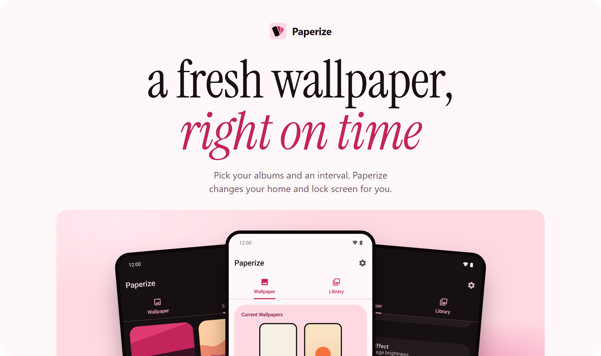

<picture>
  <source media="(prefers-color-scheme: dark)" srcset=".github/readme/hero-dark.png">
  
</picture>

<p align="center">
  <a href="https://github.com/Anthonyy232/Paperize/releases/latest"><b>Download the APK</b></a>
  &nbsp;·&nbsp;
  <a href="https://f-droid.org/en/packages/com.anthonyla.paperize/"><b>F-Droid</b></a>
  &nbsp;·&nbsp;
  <a href="https://apt.izzysoft.de/fdroid/index/apk/com.anthonyla.paperize"><b>IzzyOnDroid</b></a>
  &nbsp;·&nbsp;
  <a href="https://anthonyy232.github.io/Paperize/"><b>Website</b></a>
</p>

Paperize is an Android app that changes your home and lock screen wallpaper on a schedule, from albums you build out of your own images and folders. It works offline, has no internet permission, and needs Android 12 or newer.

<picture>
  <source media="(prefers-color-scheme: dark)" srcset=".github/readme/feature-albums-dark.png">
  
</picture>

An album holds single images, whole folders, or both. Paperize rescans folders each time you open the app, and once a day while a schedule is running, so new files join the rotation by themselves; **Refresh folder** rescans one straight away. Removing something from an album never touches the file on your device.

Supported formats: JPG, PNG, WEBP, AVIF, HEIC/HEIF, BMP, GIF and TIFF.

<picture>
  <source media="(prefers-color-scheme: dark)" srcset=".github/readme/feature-schedule-dark.png">
  
</picture>

Turn on **Lock**, **Home** or both and pick an album for each. One interval covers both screens, from 15 minutes to 30 days; **Individual Scheduling** gives each screen its own. Wallpapers go in order unless **Shuffle** is on.

<picture>
  <source media="(prefers-color-scheme: dark)" srcset=".github/readme/feature-effects-dark.png">
  
</picture>

Brightness, blur, vignette and a gray filter each have a strength slider and separate switches for home and lock. **Adaptive Brightness** adjusts the wallpaper to the system's light or dark mode. Scaling is Fill, Fit, Stretch or None, and **Horizontal scrolling** lets a wide Fill wallpaper move between home-screen pages.

## How it works

1. On first launch, choose **Static Mode** or **Live Wallpaper Mode**.
2. In **Library**, tap **+** to create an album, then add images or a folder to it.
3. In **Wallpaper**, choose the screens and their albums, and set the time interval.
4. Leave the rest to Paperize. **Wallpaper changing** pauses and resumes the schedule without clearing your albums.

To skip ahead, use **Change wallpaper now** in the app, the Quick Settings tile, or the shortcut you get by long-pressing the app icon. In static mode you can also open any image in an album and set it as the wallpaper yourself. Tick **Continue rotation from here** to have the rotation carry on from that image; it is off by default and hidden while **Shuffle** is on.

## Static and live modes

**Static mode** sets ordinary wallpapers through the system, which is simple and light on the battery.

**Live wallpaper mode** runs Paperize as a live wallpaper showing one album on both screens, and adds:

- a crossfade between wallpapers
- **Double-Tap to Change**
- **Change on Screen Off**
- **Parallax Effect**, which moves the wallpaper as you swipe between home-screen pages (your launcher has to support it)
- intervals down to 1 minute; intervals under 15 minutes only run while the wallpaper is visible

Switching modes in Settings resets your albums, wallpapers and settings.

## Settings

- **Wallpaper Mode**: switch between static and live.
- **Dark Mode**, **Dynamic Theming** (Material You colours from your system) and **Animation**.
- **Battery Optimization**: Android may delay scheduled changes for apps it optimizes. Exempting Paperize keeps them on time.
- **Reset all data**: clears every album and setting.

## Privacy

Albums and settings stay on your device, and Paperize has no internet permission. Read the [privacy policy](https://anthonyy232.github.io/Paperize/#privacy).

## Translations

Paperize ships in more than 35 languages. To add or improve a language, translate it on [Crowdin](https://crowdin.com/project/paperize). Translations are reviewed there before they reach the app, and a new language is added once 90% of it has been reviewed.

## Building from source

You need Java 17 and the Android SDK (`ANDROID_HOME`, or `sdk.dir` in `local.properties`). Paperize compiles against SDK 37 and runs on Android 12 (SDK 31) and newer.

```bash
git clone https://github.com/Anthonyy232/Paperize.git
cd Paperize
./gradlew assembleDebug
```

The APK lands in `app/build/outputs/apk/debug`. Or open the folder in Android Studio and press Run.

## Contributing

Contributions are welcome. Report bugs in [issues](https://github.com/Anthonyy232/Paperize/issues), suggest features in [Discussions](https://github.com/Anthonyy232/Paperize/discussions), and read [AGENTS.md](AGENTS.md) before opening a pull request.

If Paperize is useful to you, you can support it through [GitHub Sponsors](https://github.com/sponsors/Anthonyy232).

## License

Copyright (c) 2023-2026 Anthony La.

Paperize is free software, licensed under the [GNU General Public License v3.0](LICENSE) only, and comes with no warranty.
