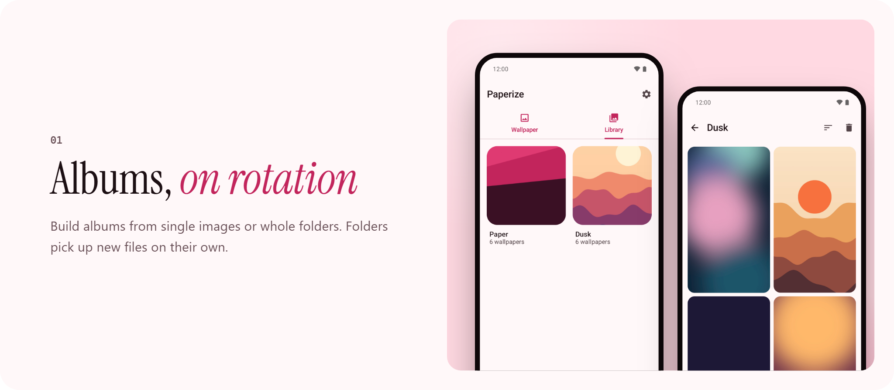
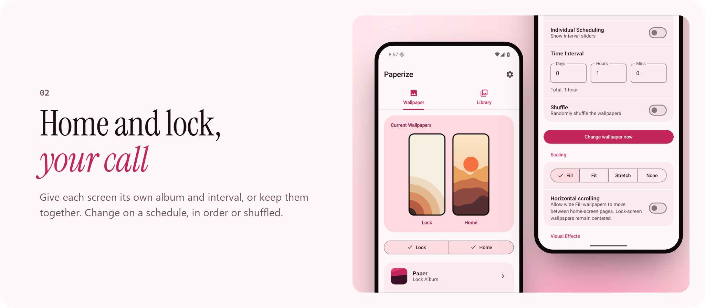
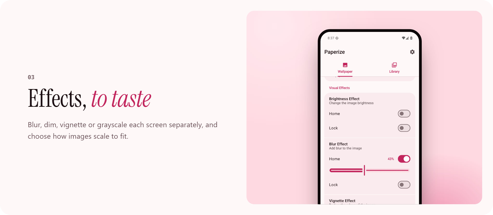

<picture>
  <source media="(prefers-color-scheme: dark)" srcset=".github/readme/hero-dark.png">
  
</picture>

<p align="center">
  <a href="https://anthonyy232.github.io/Paperize/"><b>Website</b></a>
  &nbsp;·&nbsp;
  <a href="https://github.com/Anthonyy232/Paperize/releases"><b>GitHub releases</b></a>
  &nbsp;·&nbsp;
  <a href="https://f-droid.org/en/packages/com.anthonyla.paperize/"><b>F-Droid</b></a>
  &nbsp;·&nbsp;
  <a href="https://apt.izzysoft.de/fdroid/index/apk/com.anthonyla.paperize"><b>IzzyOnDroid</b></a>
</p>

<div align="center">

**A dynamic wallpaper changer that keeps your device's aesthetic fresh and exciting**

[](https://github.com/Anthonyy232/Paperize/releases) [](https://github.com/Anthonyy232/Paperize/releases/latest) [](LICENSE) [](https://f-droid.org/en/packages/com.anthonyla.paperize/) [](https://crowdin.com/project/paperize)

</div>

Paperize is an Android app that changes your home and lock screen wallpaper on a schedule, from albums you build out of your own images and folders. It needs Android 12 or newer.

<picture>
  <source media="(prefers-color-scheme: dark)" srcset=".github/readme/feature-albums-dark.png">
  
</picture>

- **Folder Support** — Organize wallpapers into folders for auto-updating
- **Multiple Image Formats** — Supports JPG, PNG, WEBP, AVIF, HEIC/HEIF, BMP, GIF, and TIFF
- **On-Device Storage** — All wallpapers and settings stored locally on your device ([privacy policy](https://anthonyy232.github.io/Paperize/#privacy))

<picture>
  <source media="(prefers-color-scheme: dark)" srcset=".github/readme/feature-schedule-dark.png">
  
</picture>

- **Dynamic Wallpaper Changer** — Set your wallpaper to change at specific time intervals
- **Dual Screen Support** — Choose the same or separate albums for home and lock screen
- **Static & Live Wallpapers** — Choose between traditional static wallpapers or smooth live wallpaper transitions

<picture>
  <source media="(prefers-color-scheme: dark)" srcset=".github/readme/feature-effects-dark.png">
  
</picture>

- **Wallpaper Effects** — Apply various effects including brightness, blur, scaling, vignette, and more

---

## Localization

Help translate Paperize into your language! Currently, most translations are provided using machine translation — contributions from native speakers are greatly appreciated.

**[Contribute on Crowdin →](https://crowdin.com/project/paperize/invite?h=d8d7a7513d2beb0c96ba9b2a5f85473e2084922)**

---

## Tech Stack

| Category | Technology |
|----------|------------|
| **Language** | [Kotlin](https://kotlinlang.org/) |
| **UI Framework** | [Jetpack Compose](https://developer.android.com/develop/ui/compose) |
| **Design System** | [Material 3](https://m3.material.io/) |
| **Dependency Injection** | [Dagger Hilt](https://dagger.dev/hilt/) |
| **Database** | [Room](https://developer.android.com/training/data-storage/room) |
| **Image Loading** | [Coil](https://coil-kt.github.io/coil/) |

<details>
<summary><b>View all dependencies</b></summary>

- [Zoomable](https://github.com/usuiat/Zoomable) — Zoomable and pannable views

</details>

---

## Building from Source

You need Java 17 and the Android SDK (`ANDROID_HOME`, or `sdk.dir` in `local.properties`). Paperize compiles against SDK 37 and runs on Android 12 (SDK 31) and newer.

```bash
git clone https://github.com/Anthonyy232/Paperize.git
cd Paperize
./gradlew assembleDebug
```

The APK lands in `app/build/outputs/apk/debug`. Or open the folder in Android Studio and press Run.

---

## Contributing

Contributions are welcome! Feel free to:

- Report bugs by opening an [issue](https://github.com/Anthonyy232/Paperize/issues)
- Suggest features or improvements in [Discussions](https://github.com/Anthonyy232/Paperize/discussions)
- Submit pull requests; [AGENTS.md](AGENTS.md) has the conventions and the checks to run

---

## Support

If you find Paperize useful, consider supporting development through [GitHub Sponsors](https://github.com/sponsors/Anthonyy232) (one-time or monthly). Thank you!

---

## License

This project is licensed under the **GNU General Public License v3.0** — see the [LICENSE](LICENSE) file for details.
